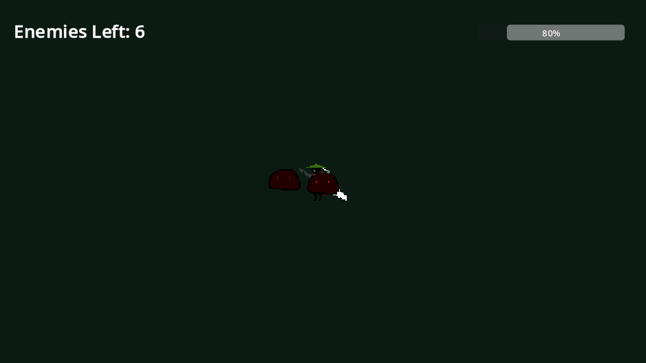
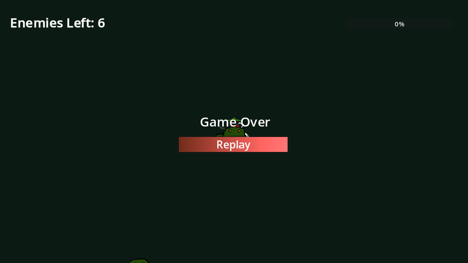
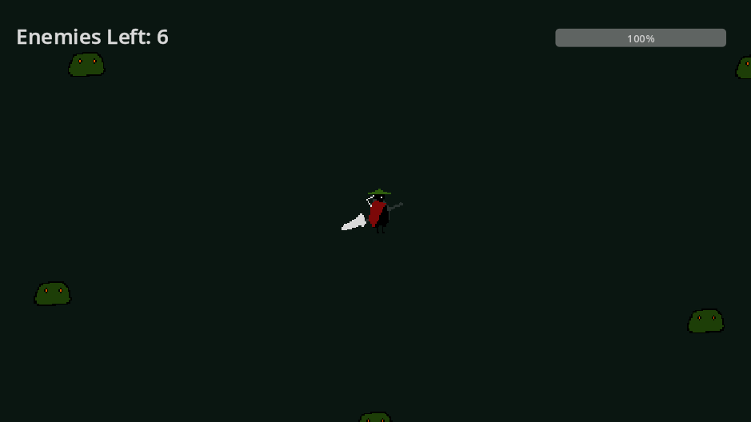
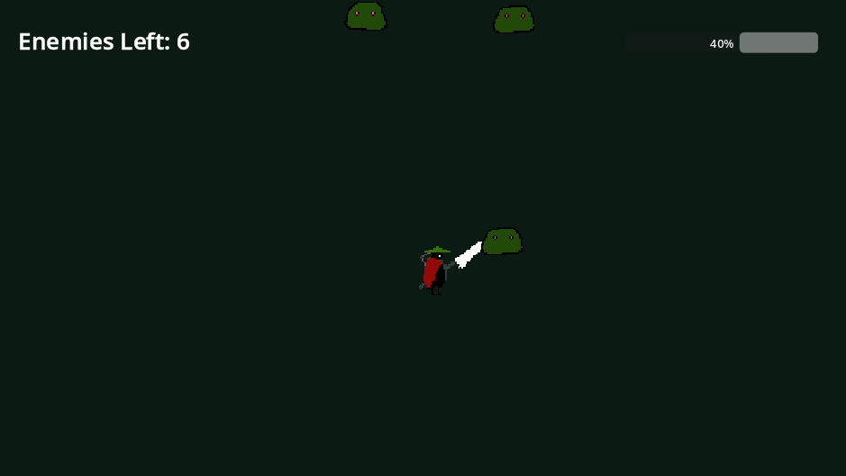
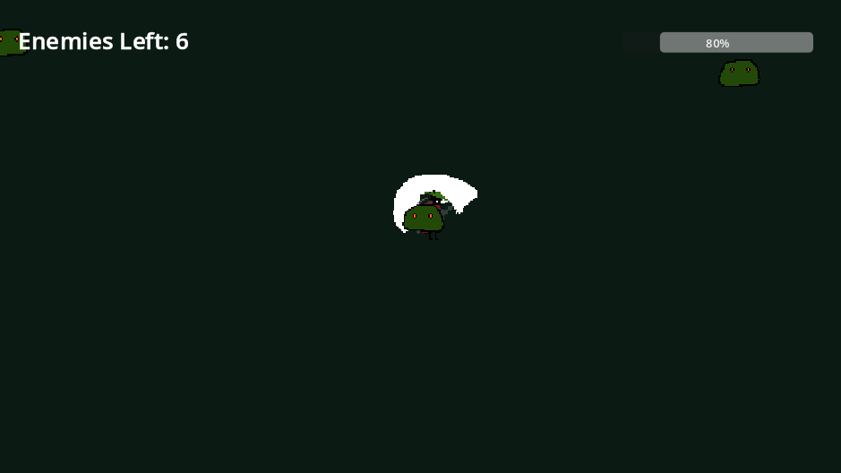
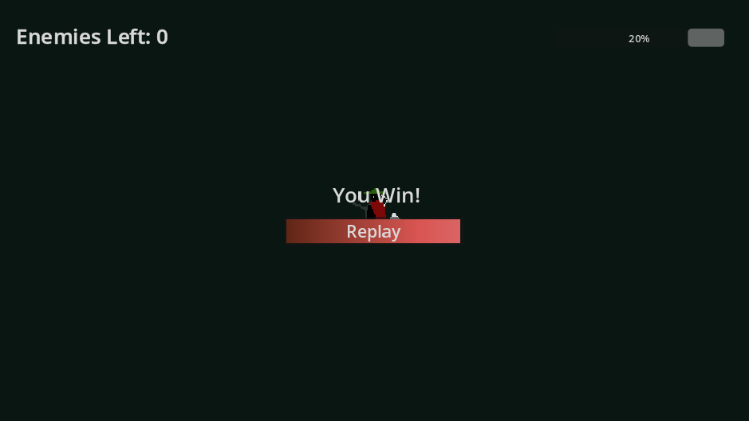

# Milo
**Milo** is a 2d top-down game made in godot
You play as **Milo**, a  noble fighter who's out in the wild fighting evil slimes.
Swing your sword and Kill the 7 evil slimes to win the game.

## Gameplay and Controls:
- Move with the arrow keys.
- Swing your sword by pressing Z.
- Dodge the slimes when they dash by moving around them.
- press the replay button to start again after winning or losing.

## screenshots

## setup
### Play the game
**Play on itch.io:** https://nullintherandomness.itch.io/milo
### Explore the project
1- Clone the repository
2- Open it with Godot
3- Enjoy

## Built using
- Godot
- Libresprite
- SFXR
## AI usage
AI was only used to help debug code and answer programming related questions not write it, everything was made by me from assets to code.

## Credit
**Ambient sound**: "Dark Ambient" - https://opengameart.org/content/dark-ambient-0
Everything else was done by me

**Made for Hackclub Phantom**
